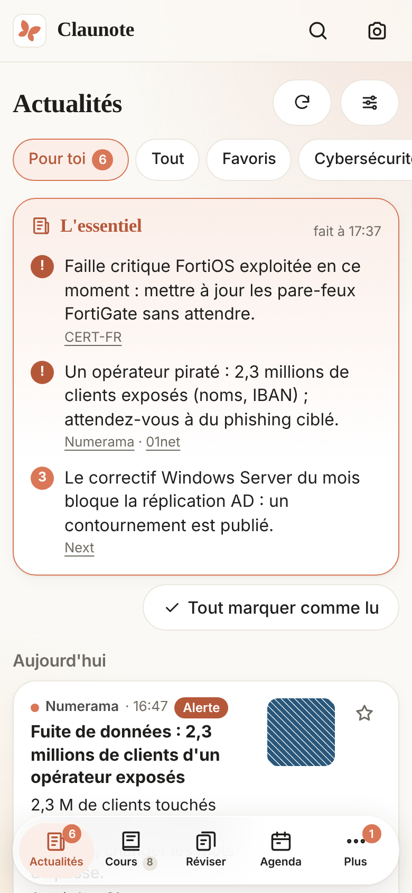
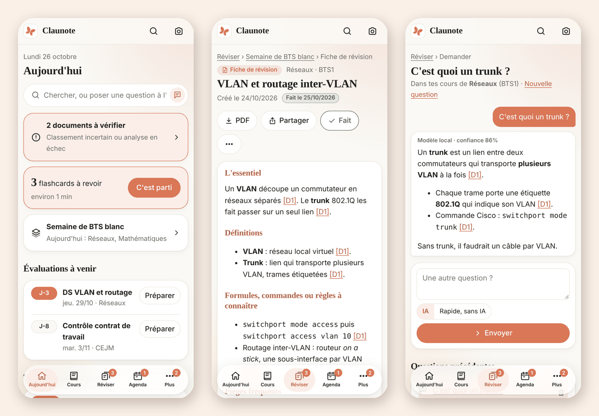
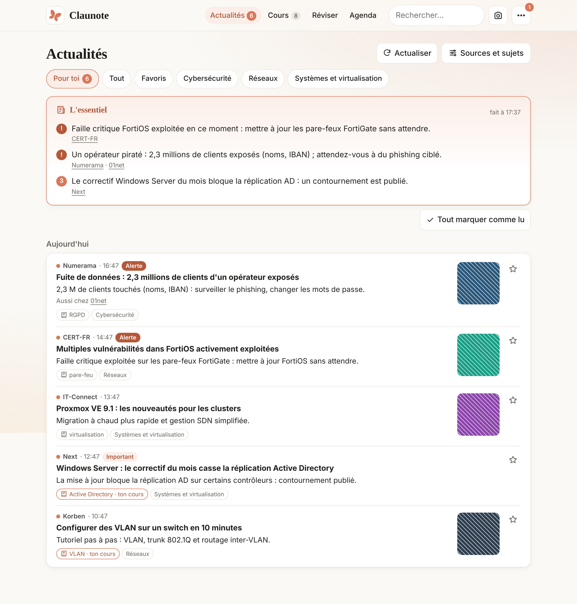
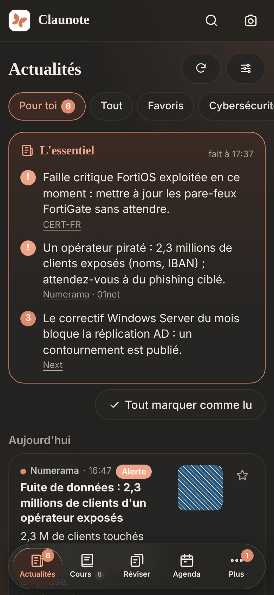
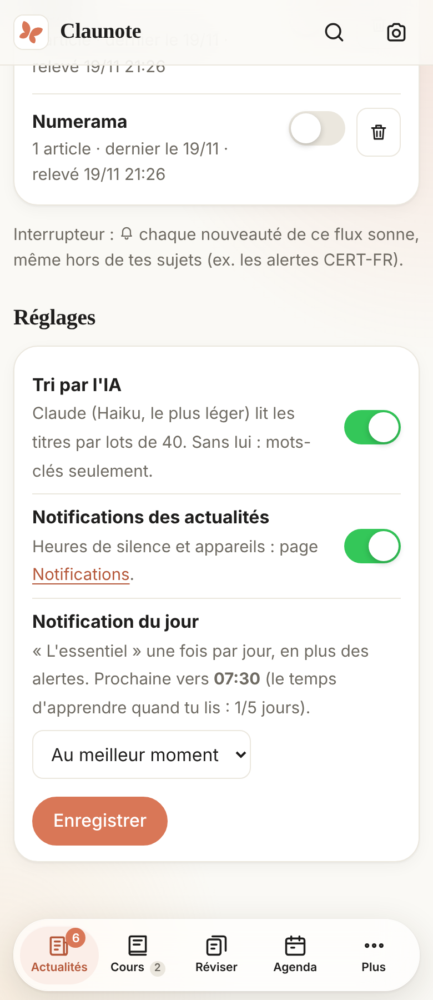
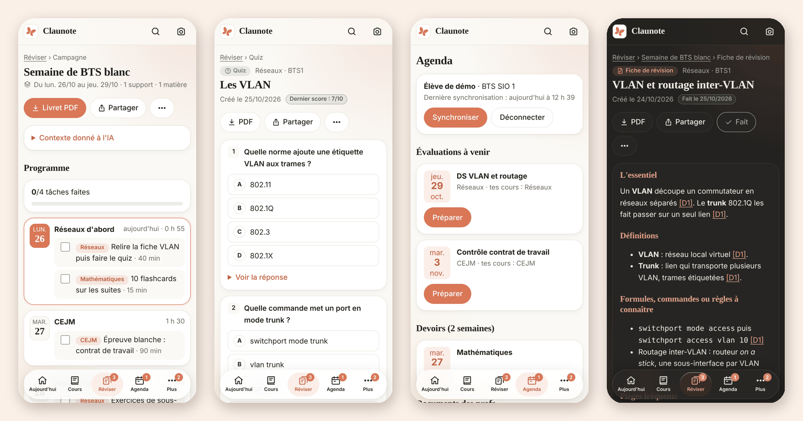
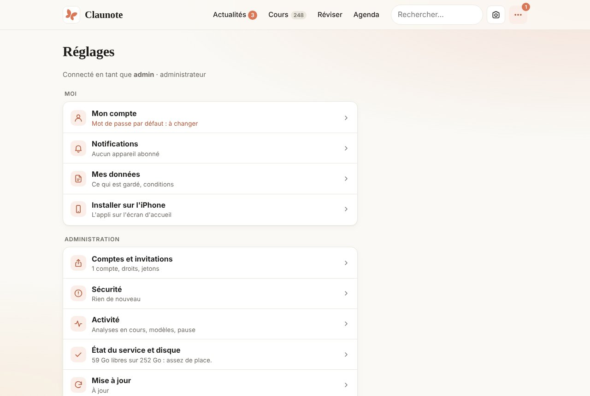
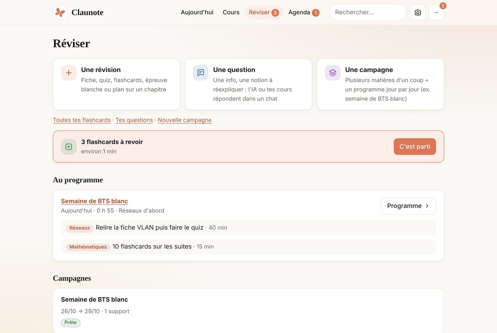
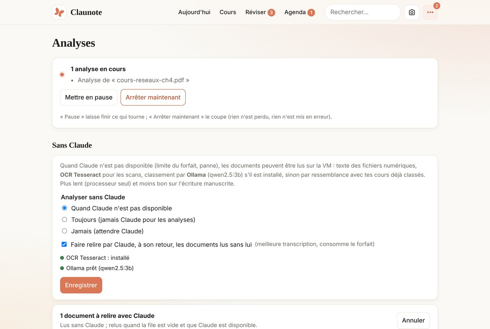
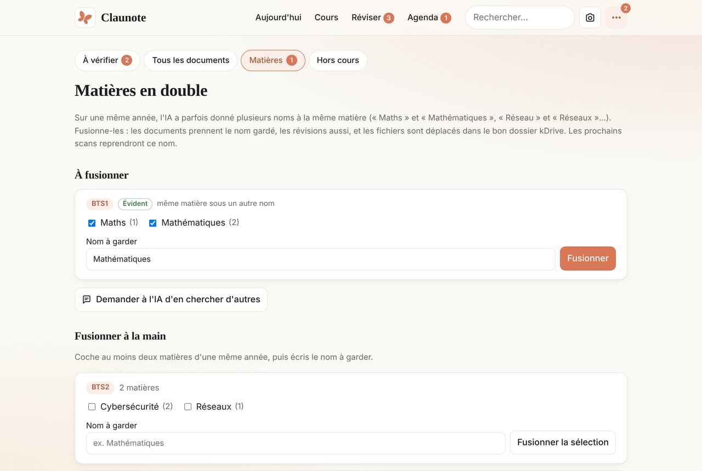

<div align="center">


# Claunote

[English](README.md) · **Français**

**Tes cours scannés, rangés et transformés en révisions par une IA, plus ta veille d'actualités triée pour toi.
Sur ton propre serveur.**

Tu scannes tes cahiers et tes TP (ou tu les déposes depuis ton téléphone). Claunote les lit, les range par année et
par matière, puis te prépare **fiches, quiz, flashcards et épreuves blanches qui citent tes propres cours**.
Chaque jour, il te résume **l'essentiel de l'actualité** de ton domaine.


&nbsp;


</div>

---

**Sommaire** · [Actualités](#-actualités--ta-veille-sans-effort) · [Ce que fait Claunote](#ce-que-fait-claunote) ·
[Captures](#captures) · [Démarrer](#démarrer-en-5-minutes) · [Vie privée et coûts](#vie-privée-et-coûts) ·
[Documentation](#documentation)

## 📰 Actualités : ta veille sans effort

La page d'ouverture de l'appli. Tu ajoutes des sites (une simple adresse suffit, le flux RSS est trouvé tout seul)
et des sujets à suivre. **Claude trie, résume et regroupe** ; toi, tu lis seulement ce qui compte.

<p align="center">
  
</p>

| | |
| --- | --- |
| 🗞️ **L'essentiel du jour** | En haut de « Pour toi » : **les 3 à 5 infos du moment en une phrase chacune**, avec leurs sources. Écrit par **Claude Opus 5.5**, refait au plus toutes les 3 h (ou tout de suite pour une alerte). |
| 🔔 **Notification du jour** | L'essentiel arrive **une fois par jour, à l'heure où tu lis d'habitude** (apprise sur 4 semaines, 7 h 30 au départ). Heure fixe ou désactivation possibles. |
| 🚨 **Alertes rares** | Seules les infos **graves** sonnent tout de suite : grosse fuite de données, faille critique exploitée, panne majeure. **Une seule fois par événement**, jamais pendant tes heures de silence. |
| 🧩 **Une info = une carte** | Le même événement repris par 3 sites devient **une seule carte** « Aussi chez Numerama · 01net ». Un résumé d'une phrase par article. |
| 📚 **Lié à tes cours** | Quand un article parle d'une notion que tu as en cours (VLAN, Active Directory, RGPD…), un lien **« · ton cours »** ouvre le bon document. |
| 🎯 **Pour toutes les formations** | Les sujets de départ se modifient ; le tri tient compte de **la formation que tu as indiquée**. Option Google Actualités par sujet, favoris, « Tout marquer comme lu ». |

<p align="center">
  
  &nbsp;
  
</p>

Comment l'info circule, du flux RSS à la notification : **[schéma Actualités](docs/schemas.md#actualités--du-flux-rss-à-la-notification)**.

## Ce que fait Claunote

| | |
| --- | --- |
| 📥 **Tout ranger sans effort** | Scans, photos d'iPhone, PDF, Word, PowerPoint, Excel, code de TP… Un fichier, **un dossier entier mal rangé** ou un scan de 300 pages : tri sans IA, découpage des gros scans, puis lecture et classement par **année / matière / type**. |
| 🎓 **Matières par formation** | Tu indiques ta formation pour chaque année : Claude récupère **le référentiel officiel** et propose les bons noms de matières. Chaque correction devient **une règle** suivie par les prochains dépôts. Doublons (« Maths » / « Mathématiques ») détectés et fusionnés. |
| 🧠 **Réviser en une phrase** | « une fiche de CEJM sur le contrat pour jeudi » suffit. **Fiche synthèse dense** (PDF A4 sur 3 colonnes, modifiable par une simple demande), quiz corrigé, flashcards **FSRS** (export Anki), épreuve blanche, plan jour par jour, carte mentale, formules KaTeX. Chaque point renvoie à ton cours `[D1]`. |
| ✨ **Opus 5.5 pour créer** | **Toute création de contenu passe par Claude Opus 5.5**, avec un garde-fou qui compare à tes anciennes fiches pour éviter le hors-sujet. |
| 💬 **Une question** | Un chat qui lit **tous tes documents** et ton agenda Pronote. Mode instantané sans IA, photo d'une formule → LaTeX. |
| 🗓️ **Campagnes** | « Semaine de BTS blanc » : plusieurs matières d'un coup, programme jour par jour à cocher, livret PDF. |
| 🎓 **Pronote** | Évaluations, devoirs, notes et documents des profs toutes les 3 h ; une fiche est **préparée toute seule avant chaque contrôle**. |
| 👥 **Plusieurs comptes** | Invitations de 15 min, **droits par fonctionnalité** (dont l'usage de ton forfait Claude). Chaque compte a ses données, isolées par la base. |
| 🔒 **Public ou privé** | Chaque cours, matière, fiche ou campagne : **🔒 Moi seul** (par défaut) ou **🌐 Tous les comptes**. Page *Partagés* en lecture seule. |
| 🗄️ **Archives** | Ménage **proposé, jamais automatique** : contrôles passés, flashcards et fiches délaissées. Archiver, garder ou restaurer. |
| 🛡️ **Garde-fou** | RIB, pièce d'identité, document de santé : repérés **sur le serveur, avant l'IA**, et jamais envoyés à Claude. |
| 🖥️ **Local d'abord** | Lecture, classement et chat se font **sur le processeur du serveur** (Tesseract + Ollama). Claude n'aide que si le local doute, et en contrôle 1 sur 10. |
| 📱 **Appli iPhone** | Installable sur l'écran d'accueil : notifications push, thème clair/sombre, **Face ID**. Pas d'App Store. |

**Navigation** : quatre onglets **Actualités · Cours · Réviser · Agenda**, et **Plus** pour *Ajouter*, *Ranger* et
une seule page *Réglages* (Moi / Administration).

## Captures

<p align="center">
  
</p>

| Réglages | Réviser |
| --- | --- |
|  |  |
| **Activité** : pause, arrêt, qui fait le travail | **Ranger → Matières** |
|  |  |

<sub>Données de démonstration fictives.</sub>

## Démarrer en 5 minutes

Il te faut **une VM Linux avec Docker** (4 vCPU · 8 Go · 40 Go conseillés, pas de GPU), **un abonnement Claude Pro
ou Max** et **un VPN** (ou Cloudflare Tunnel). kDrive Infomaniak et Pronote sont facultatifs.

```bash
git clone https://github.com/juteaucorp/claunote && cd claunote
cp .env.example .env            # remplis POSTGRES_PASSWORD et BIND_ADDR (l'IP de la VM sur ton VPN)
docker compose up -d --build    # 10 à 20 min la première fois (modèle local ~2,3 Go)
```

Ouvre `http://<IP-de-la-VM>:8000`, connecte-toi avec `admin` / `claunote` : **un assistant pas à pas** te fait
choisir ton mot de passe, le stockage (kDrive, la VM ou les deux), colle ton jeton Claude (`claude setup-token`) et
branche Pronote. Les jetons sont **chiffrés** et jamais réaffichés.

➡️ Tout le détail (prérequis, `.env`, VPN ou Internet, comptes, mise à jour, réglages, dépannage) :
**[docs/installation.md](docs/installation.md)**.

## Vie privée et coûts

- **Tes fichiers restent chez toi** : sur ta VM et/ou ton kDrive. Le site n'est **jamais exposé directement** sur
  Internet (VPN, ou Cloudflare Tunnel réservé à tes appareils approuvés).
- **Aucune facturation à l'usage** : seul le jeton de ton forfait Claude est utilisé, une clé API serait ignorée.
  À la limite du forfait, Claunote attend ou passe en local. Rien n'est jamais acheté.
- **Documents personnels** repérés par le garde-fou : jamais envoyés à Claude.
- **Modèle local** : rien ne sort de la VM ; Claude ne voit que ce que le local n'a pas su faire seul.

## Documentation

| | |
| --- | --- |
| 🛠️ **[Installer et administrer](docs/installation.md)** | Prérequis, installation, `.env`, accès, comptes, mise à jour, réglages avancés, dépannage |
| 🗺️ **[Schémas](docs/schemas.md)** | Vue d'ensemble, parcours d'un document, Actualités, local ou Claude, accès, comptes, mise à jour |
| 📋 **[Guide pas à pas](infra/SETUP.md)** | Chaque étape avec ses tests : kDrive, Pronote, iPhone, notifications, Face ID, modèles locaux |
| 🌐 **[Cloudflare Tunnel](docs/cloudflare-tunnel.md)** | Ouvrir le site par Internet sans VPN, appareils approuvés |
| 👩‍💻 **[Développement](docs/developpement.md)** | Tests, organisation du code, historique des étapes |
| 🔐 **[Sécurité](SECURITY.md)** | Signaler une faille |

## Licence

[MIT](LICENSE).
