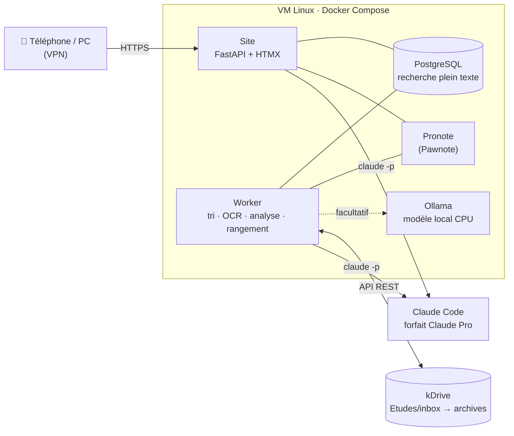
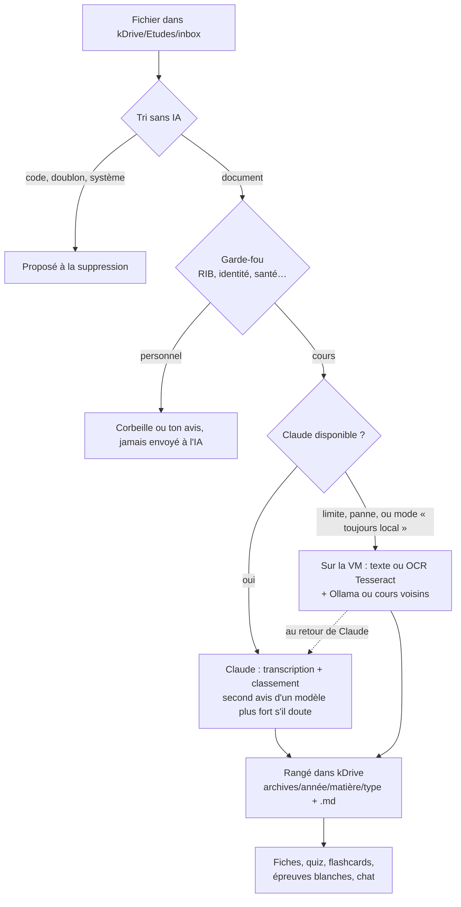
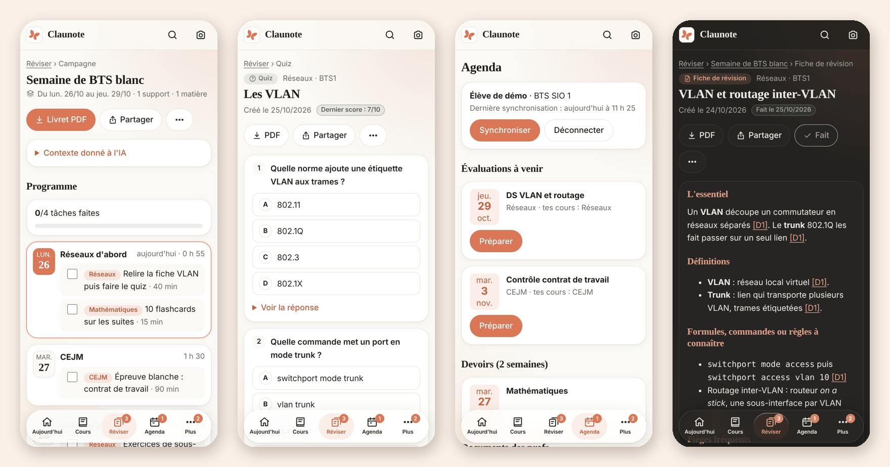
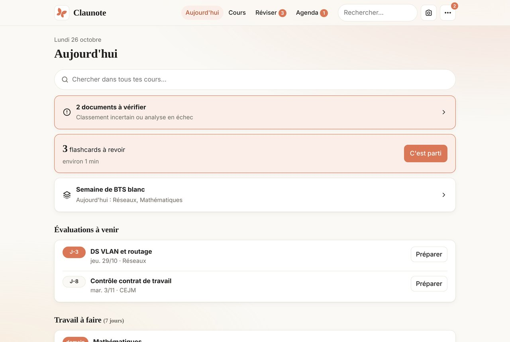

<div align="center">


# Claunote

**Tous tes cours (du collège au BTS) scannés, rangés et transformés en révisions par une IA,
sur ton propre serveur.**

Tu scannes tes cahiers et tes TP, ou tu les déposes depuis ton téléphone. Claunote les lit, les classe par année,
matière et type, puis te prépare des fiches, des quiz, des flashcards et des épreuves blanches qui citent tes
propres cours. Il récupère aussi tes évaluations sur Pronote et te dit quoi réviser aujourd'hui.


</div>

---

## Sommaire

- [Ce que fait Claunote](#ce-que-fait-claunote)
- [Comment ça marche](#comment-ça-marche)
- [Captures](#captures)
- [Installation](#installation)
- [Réglages principaux](#réglages-principaux)
- [Vie privée et coûts](#vie-privée-et-coûts)
- [Développement](#développement)
- [Organisation du code](#organisation-du-code)

## Ce que fait Claunote

| | |
| --- | --- |
| 📥 **Tout ranger sans effort** | Scans, photos d'iPhone (HEIC), PDF, Word, PowerPoint, Excel… Tu déposes un fichier, un dossier entier même mal rangé, ou un scan de 300 pages. Claunote fait le tri sans IA (code, doublons PDF/Word, pages à fusionner), découpe les gros scans en documents, puis l'IA transcrit et classe chaque document dans `kDrive/Etudes/archives/<année>/<matière>/<type>`. |
| 🛡️ **Garde-fou** | Un RIB, une pièce d'identité ou un document de santé oublié dans un import est repéré **sur le serveur, avant l'IA**, et n'est jamais envoyé à Claude. |
| 📚 **Bibliothèque** | Tes cours par année et par matière, recherche plein texte dans toutes les transcriptions, et les documents dont le classement est incertain mis de côté pour toi. |
| 🧠 **Réviser** | Fiche, quiz corrigé, flashcards (répétition espacée et export Anki), épreuve blanche avec corrigé, plan jour par jour jusqu'à l'évaluation. Chaque point renvoie au cours d'origine `[D1]`. Le web n'est utilisé qu'en complément `[W1]`. |
| 💬 **Une question** | Un chat pour une info rapide. Claude répond à partir de tes cours, ou bien un mode instantané **sans IA** te montre les passages de tes cours qui en parlent. |
| 🗓️ **Campagnes** | « Semaine de BTS blanc » : plusieurs matières et plusieurs supports d'un coup, plus un programme jour par jour, à cocher, et un livret PDF. |
| 🎓 **Pronote** | Évaluations, devoirs, notes et documents des profs, synchronisés toutes les 3 h. Une fiche ou un plan est préparé tout seul avant chaque contrôle. |
| 🖥️ **Sans Claude aussi** | Si ton forfait Claude est à sa limite (ou si tu préfères), les documents sont lus **sur le processeur du serveur** : OCR Tesseract, puis classement par [Ollama](https://ollama.com) ou par ressemblance avec tes cours. Claude les relit à son retour. |
| ⏯️ **Tu gardes la main** | Page *Analyses* : mise en pause, arrêt immédiat des analyses en cours, et actions de masse sur la file d'attente. Page *Organiser* : reclasser, déplacer ou supprimer en masse. Fusion des matières en double (« Maths » / « Mathématiques »). |
| 📱 **Appli iPhone** | Une appli web installable sur l'écran d'accueil, avec notifications push et thème clair ou sombre. Pas d'App Store, pas de compte développeur. |

## Comment ça marche



Le parcours d'un document :



## Captures

<p align="center">
  
</p>

| Aujourd'hui | Réviser |
| --- | --- |
|  |  |
| **Analyses** : pause, arrêt, analyse sans Claude, file | **Matières en double** |
|  |  |

<sub>Données de démonstration fictives.</sub>

## Installation

Il te faut une VM Linux (2 vCPU et 4 Go de RAM suffisent, 8 Go avec Ollama), Docker, un kDrive Infomaniak
et un abonnement Claude Pro. Le guide pas à pas est dans **[infra/SETUP.md](infra/SETUP.md)** : VPN, jeton kDrive,
Claude Code, Pronote, HTTPS pour l'iPhone, notifications.

```bash
git clone https://github.com/ctrljuteau/claunote && cd claunote
cp .env.example .env          # jetons kDrive et Claude, mot de passe du site…
docker compose up -d --build  # site, worker, base, Pronote, HTTPS
# facultatif : analyse sans Claude par un modèle local (télécharge ~2 Go au premier lancement)
docker compose --profile local up -d
```

Ensuite, ouvre `http://<IP-VPN-de-la-VM>:8000`, connecte-toi, et dépose un premier scan.

## Réglages principaux

Tout se règle dans `.env` (voir les commentaires de [.env.example](.env.example)). Les réglages du quotidien
se font aussi sur le site.

| Variable | Rôle | Défaut |
| --- | --- | --- |
| `KDRIVE_TOKEN`, `KDRIVE_ID`, `KDRIVE_ETUDES_ID`, `KDRIVE_INBOX_ID` | Accès à kDrive | à remplir |
| `CLAUDE_CODE_OAUTH_TOKEN` | Jeton du forfait Claude Pro (`claude setup-token`) | à remplir |
| `CLAUDE_MODELES`, `CLAUDE_MODELE_MAX` | Un modèle par tâche (Haiku, Sonnet, Opus), plafond | voir la page *État* |
| `CLAUDE_PARALLELE` | Appels à Claude en même temps | `3` |
| `ANALYSE_LOCALE` | Analyse sans Claude : `auto`, `toujours` ou `jamais` (aussi sur la page *Analyses*) | `auto` |
| `OLLAMA_MODELE`, `LOCAL_PARALLELE` | Modèle local, et analyses locales en même temps | `qwen2.5:3b`, `1` |
| `PRONOTE_INTERVALLE_H`, `PRONOTE_PREPARATION_AUTO` | Synchro Pronote, préparation automatique des contrôles | `3`, `1` |
| `CLAUNOTE_UTILISATEUR`, `CLAUNOTE_MOT_DE_PASSE` | Connexion au site (mot de passe changeable sur le site) | `admin` / `claunote` |
| `DECOUPAGE_PAGES` | Au-delà, un PDF est d'abord découpé en documents | `40` |

## Vie privée et coûts

- **Tes fichiers restent chez toi** : dans kDrive et sur ta VM. Le site n'écoute que sur ton VPN.
- **Pas de facturation à l'usage.** Seul le jeton du forfait Claude Pro est utilisé, et une clé API présente
  serait ignorée. À la limite du forfait, Claunote attend, ou bien bascule sur l'analyse locale. Rien n'est
  jamais acheté.
- **Les documents personnels** repérés par le garde-fou ne sont jamais envoyés à Claude.
- **L'analyse locale** (Tesseract, Ollama) ne fait sortir aucune donnée de la VM.

## Développement

```bash
cd app
pip install -r requirements.txt pytest
pytest                      # ~300 tests, sans base ni kDrive (tout est simulé)
cd ../pronote && npm test   # service Pronote
```

Les tests de lecture locale (OCR) se lancent si Tesseract est installé (`apt install tesseract-ocr tesseract-ocr-fra`).

## Organisation du code

| Fichier | Rôle |
| --- | --- |
| `app/claunote/main.py` | Site FastAPI : pages, formulaires, HTMX |
| `app/claunote/worker.py` | Boucle du worker : inbox, tri, analyses, rangement, révisions, Pronote, pause et arrêt |
| `app/claunote/agent.py` | Appels à Claude Code (`claude -p`), modèle par tâche, escalade, limites, arrêt d'un appel en cours |
| `app/claunote/local.py` | Analyse sans Claude : texte, OCR Tesseract, Ollama, vote des cours voisins |
| `app/claunote/importation.py`, `decoupage.py`, `sensible.py`, `ocr.py` | Tri d'un import, découpage des gros scans, garde-fou, lecture locale |
| `app/claunote/revision.py`, `question.py`, `pdf.py`, `anki.py` | Supports de révision, chat, PDF, export Anki |
| `app/claunote/matieres.py`, `rangement.py` | Matières en double, chemins et noms dans kDrive |
| `app/claunote/pronote.py`, `pronote/` | Client Python et service Node (Pawnote) |
| `app/claunote/db.py` | Schéma PostgreSQL (créé et mis à jour au démarrage) et requêtes |
| `infra/` | Caddy (HTTPS local) et guide d'installation |

<details>
<summary><strong>Historique des étapes</strong></summary>

- [x] VM, accès kDrive par API, Docker Compose
- [x] Pipeline d'ingestion : transcription et classement par Claude Code
- [x] Site : bibliothèque, recherche, documents « à vérifier »
- [x] Agent de révision : fiches, quiz, plans, sources citées
- [x] Pronote : agenda, devoirs, notes, documents des profs, préparation en un clic
- [x] Flashcards (répétition espacée), export Anki, appli installable
- [x] Organiser : reclassement, actions de masse, espace « Hors cours »
- [x] Appli iPhone (HTTPS local, style Liquid Glass), notifications push
- [x] Imports de dossiers entiers, garde-fou des documents personnels, découpage des très gros scans
- [x] Campagnes multi-matières, épreuves blanches, PDF à partager, fichiers joints au contexte
- [x] « Une question » : chat avec l'IA ou sans IA
- [x] Matières en double : détection, fusion, prévention
- [x] Analyse sans Claude sur CPU (Tesseract + Ollama), pause et arrêt des analyses, file d'analyse

</details>
