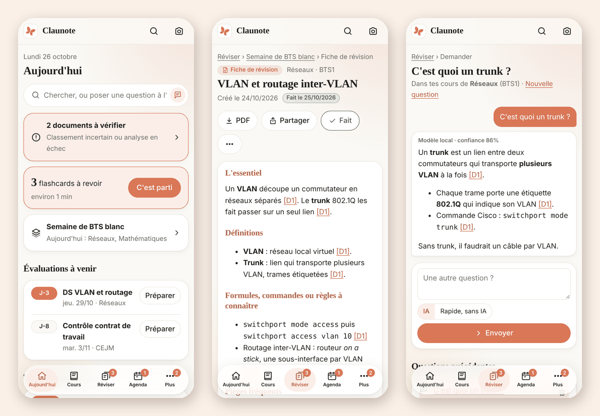
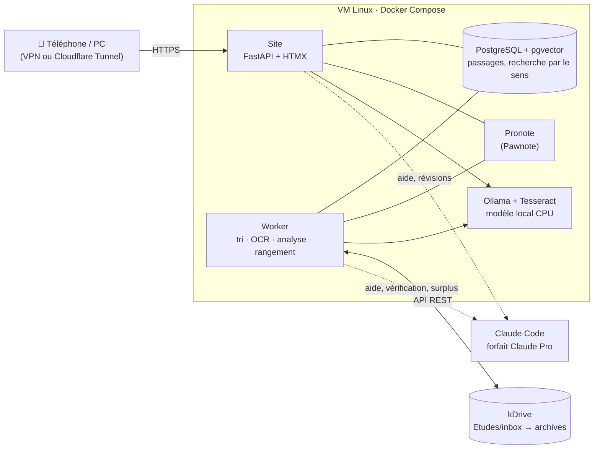
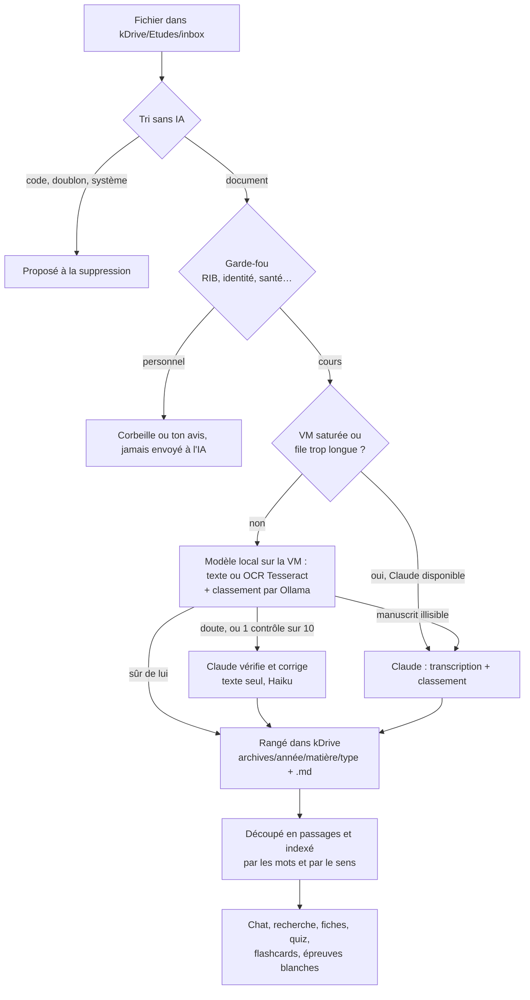
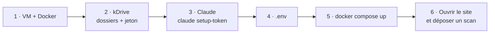

<div align="center">


# Claunote

**Tous tes cours (du collège aux études supérieures) scannés, rangés et transformés en révisions par une IA,
sur ton propre serveur.**

Tu scannes tes cahiers et tes TP, ou tu les déposes depuis ton téléphone. Claunote les lit, les classe par année,
matière et type, puis te prépare des fiches, des quiz, des flashcards et des épreuves blanches qui citent tes
propres cours. Il récupère aussi tes évaluations sur Pronote et te dit quoi réviser aujourd'hui.



</div>

---

## Sommaire

- [Ce que fait Claunote](#ce-que-fait-claunote)
- [Comment ça marche](#comment-ça-marche)
- [Captures](#captures)
- [Ce qu'il te faut](#ce-quil-te-faut)
- [Installation](#installation)
- [Le fichier .env](#le-fichier-env)
- [Ouvrir le site : VPN ou Internet](#ouvrir-le-site--vpn-ou-internet)
- [Mettre à jour](#mettre-à-jour)
- [Réglages avancés](#réglages-avancés)
- [Vie privée et coûts](#vie-privée-et-coûts)
- [Dépannage rapide](#dépannage-rapide)
- [Développement](#développement)
- [Organisation du code](#organisation-du-code)

## Ce que fait Claunote

| | |
| --- | --- |
| 📥 **Tout ranger sans effort** | Scans, photos d'iPhone (HEIC), PDF, Word, PowerPoint, Excel, scripts et notebooks de TP… Tu déposes un fichier, un dossier entier même mal rangé, ou un scan de 300 pages. Claunote fait le tri sans IA (code, doublons PDF/Word, pages à fusionner), découpe les gros scans en documents, puis l'IA transcrit et classe chaque document dans `kDrive/Etudes/archives/<année>/<matière>/<type>`. |
| 🛡️ **Garde-fou** | Un RIB, une pièce d'identité ou un document de santé oublié dans un import est repéré **sur le serveur, avant l'IA**, et n'est jamais envoyé à Claude. |
| 📚 **Bibliothèque** | Tes cours par année et par matière. Chaque document est découpé en passages et indexé : la recherche trouve le bon morceau du bon cours, par les mots et **par le sens**. |
| 🧠 **Réviser** | Fiche, quiz corrigé, flashcards (répétition espacée **FSRS**, l'algorithme d'Anki, et export Anki), épreuve blanche avec corrigé, plan jour par jour jusqu'à l'évaluation, **carte mentale** de chaque fiche ou cours. Formules de maths, de physique et de chimie dessinées proprement (**KaTeX**). Chaque point renvoie au cours d'origine `[D1]`. Le web n'est utilisé qu'en complément `[W1]`. |
| 📈 **Progression** | Série de jours de travail, flashcards par jour, mémoire estimée par FSRS, réussite par matière (cartes et quiz), moyennes et tendance des notes Pronote. |
| 💬 **Une question** | Un chat (ou la barre de recherche de l'accueil) qui lit **tous tes documents** et ton agenda Pronote. Les passages sont relus et triés par un petit modèle local (**FlashRank**) avant la réponse. Le modèle local répond, Claude vérifie et complète quand il doute. Un mode instantané **sans IA** montre les passages qui en parlent. **Photo d'une formule** → LaTeX dans ta question (**pix2tex**). |
| 🗓️ **Campagnes** | « Semaine de BTS blanc » : plusieurs matières et plusieurs supports d'un coup, plus un programme jour par jour, à cocher, et un livret PDF. |
| 🎓 **Pronote** | Évaluations, devoirs, notes et documents des profs, synchronisés toutes les 3 h. Une fiche ou un plan est préparé tout seul avant chaque contrôle. |
| 🖥️ **Local d'abord** | Le travail interne (lecture, classement, noms de dossiers, matières, chat) est fait **sur le processeur du serveur** : OCR Tesseract et [Ollama](https://ollama.com). Quand le modèle local doute ou n'arrive pas à lire (écriture manuscrite), il demande à Claude, qui vérifie et corrige. Une analyse sûre sur 10 est contrôlée quand même, pour mesurer sa fiabilité. Si la VM sature ou si la file s'allonge, le surplus part chez Claude. Des pics à 100 %, jamais une VM à fond en permanence : au-delà de 60 % en moyenne sur 15 min, le travail de fond ralentit. |
| ⏯️ **Tu gardes la main** | *Activité* : mise en pause, arrêt immédiat des analyses en cours, actions de masse sur la file, choix de qui fait le travail. *Ranger* : documents à vérifier, actions de masse, matières en double (« Maths » / « Mathématiques »). |
| 📰 **Actualités** | Ta veille techno (sujets de départ orientés BTS SIO option SISR, modifiables) : les flux RSS que tu ajoutes (une adresse de site suffit) et les sujets que tu suis (cybersécurité, réseaux, systèmes et virtualisation…). Claude (Haiku) trie les nouveaux articles par lots et garde dans « Pour toi » ceux qui comptent, avec une phrase sur ce qu'il faut retenir. Les plus importants sonnent sur le téléphone, regroupés, jamais pendant le silence. Un sujet peut aussi chercher sur Google Actualités. |
| 📱 **Appli iPhone** | Une appli web installable sur l'écran d'accueil, avec notifications push, thème clair ou sombre et **connexion par Face ID** (clés d'accès). Pas d'App Store, pas de compte développeur. |

## Comment ça marche



Le parcours d'un document :



## Captures

<p align="center">
  
</p>

| Aujourd'hui | Réviser |
| --- | --- |
|  |  |
| **Activité** : pause, arrêt, qui fait le travail, fiabilité du local | **Ranger → Matières** |
|  |  |

<sub>Données de démonstration fictives.</sub>

## Ce qu'il te faut

| | Obligatoire ? | Pourquoi | Où le trouver |
| --- | --- | --- | --- |
| 🖥️ **Une VM Linux avec Docker** | **oui** | Tout tourne dedans (site, worker, base, modèles locaux) | Debian 12 / Ubuntu 24.04, **4 vCPU · 8 Go RAM · 40 Go SSD** conseillés (2 vCPU · 4 Go avec `OLLAMA_MODELE=qwen2.5:1.5b`). Aucun GPU. |
| 🤖 **Un abonnement Claude Pro (ou Max)** | **oui** | L'IA passe par Claude Code (`claude -p`) avec **le jeton de ton forfait**, pas par une clé API : **aucune facturation à l'usage** | [claude.ai](https://claude.ai), puis `claude setup-token` (voir l'étape 3) |
| ☁️ **Un kDrive Infomaniak** | **oui** | Tes scans y arrivent (`Etudes/inbox`) et y sont rangés (`Etudes/archives/…`) | [Jeton API](https://manager.infomaniak.com/v3/ng/accounts/token/list) avec le scope `drive` |
| 🔒 **Un moyen d'ouvrir le site** | **oui** | Le site n'est **jamais** exposé directement sur Internet | Ton VPN (WireGuard, OpenVPN…), ou Cloudflare Tunnel (voir [plus bas](#ouvrir-le-site--vpn-ou-internet)) |
| 🎓 **Un compte Pronote** | non | Agenda, devoirs, notes, documents des profs | Se branche depuis le site (page *Agenda*), QR code ou identifiants |
| 🌐 **Un domaine sur Cloudflare** | non | Seulement pour ouvrir le site **par Internet, sans VPN** | ~10 €/an, voir la [procédure Cloudflare](docs/cloudflare-tunnel.md) |
| 🔑 **Un jeton GitHub** | si le dépôt est privé | Le bouton *Mise à jour* du site fait un `git pull` | [Jeton fine-grained](https://github.com/settings/personal-access-tokens/new), voir [Mettre à jour](#mettre-à-jour) |

## Installation



**1. La VM** (en tant qu'utilisateur du groupe `docker`, pas en `sudo`) :

```bash
sudo apt install -y docker.io docker-compose-v2 git curl
git clone https://github.com/juteaucorp/claunote && cd claunote
cp .env.example .env
```

**2. kDrive** : crée un dossier `Etudes` et un dossier `inbox` dedans, puis un
[jeton API](https://manager.infomaniak.com/v3/ng/accounts/token/list) avec le scope **`drive`**.
Les identifiants se lisent dans l'adresse de kDrive web :

```
…/drive/123456/files/7890
         └─────┘       └──┘
         KDRIVE_ID      ID du dossier ouvert (Etudes, puis inbox)
```

**3. Claude** : sur la VM (ou n'importe quel PC), une seule fois :

```bash
curl -fsSL https://claude.ai/install.sh | bash   # installe Claude Code
claude setup-token                               # connexion à ton compte claude.ai → affiche un jeton (valable 1 an)
```

**4. Le `.env`** : remplis au minimum les lignes du [tableau ci-dessous](#le-fichier-env).

**5. Lancer** :

```bash
docker compose up -d --build   # site, worker, base, modèles locaux, Pronote, HTTPS, service de mise à jour
curl localhost:8000/health     # {"ok":true,"kdrive":true}
```

Le premier lancement télécharge le modèle local (~2,3 Go) : compte 10 à 20 minutes.

**6. Ouvrir** `http://<IP-VPN-de-la-VM>:8000`, se connecter (`admin` / `claunote` par défaut, **à changer
tout de suite** sur la page *Compte*), puis déposer un premier scan dans *Ajouter* ou dans `kDrive/Etudes/inbox`.

Le guide détaillé, étape par étape, avec les tests et le dépannage : **[infra/SETUP.md](infra/SETUP.md)**
(Pronote, appli iPhone, notifications, Face ID, modèles locaux…).

## Le fichier .env

Il reste **sur ta VM** (il est ignoré par git) : ne le partage jamais, il contient tes jetons.

| Variable | À remplir ? | Valeur |
| --- | --- | --- |
| `POSTGRES_PASSWORD` | **oui** | Un mot de passe au hasard (`openssl rand -hex 16`) |
| `BIND_ADDR` | **oui** | L'IP de la VM **sur ton VPN** : le site n'écoute que là. `127.0.0.1` si tu passes uniquement par Cloudflare Tunnel |
| `KDRIVE_TOKEN` | **oui** | Le jeton API Infomaniak (scope `drive`) |
| `KDRIVE_ID`, `KDRIVE_ETUDES_ID`, `KDRIVE_INBOX_ID` | **oui** | Les nombres lus dans l'adresse de kDrive web (étape 2) |
| `CLAUDE_CODE_OAUTH_TOKEN` | **oui** | Le jeton de `claude setup-token`. Une `ANTHROPIC_API_KEY` serait **ignorée** |
| `CLAUNOTE_UTILISATEUR`, `CLAUNOTE_MOT_DE_PASSE` | conseillé | Ton identifiant et ton mot de passe (changeable ensuite sur le site) |
| `GITHUB_TOKEN` | si dépôt privé | Jeton fine-grained en **lecture seule**, pour le bouton *Mise à jour* (voir [plus bas](#mettre-à-jour)) |
| `CLAUNOTE_HOTE`, `CLAUNOTE_PUSH_CONTACT` | pour l'iPhone | Adresse VPN de la VM et ton e-mail (`mailto:…`) : appli iPhone en HTTPS et notifications |
| `COMPOSE_PROFILES=tunnel`, `CLOUDFLARE_TUNNEL_TOKEN` | pour Internet | Active Cloudflare Tunnel ([procédure](docs/cloudflare-tunnel.md)) |

Pronote ne se règle pas dans le `.env` : la connexion se fait sur la page *Agenda* du site, et **ton mot de
passe Pronote n'est jamais stocké** (seul un jeton de reconnexion l'est).

## Ouvrir le site : VPN ou Internet

```
 ┌─ Par ton VPN (par défaut) ─────────────────────────────────────────────┐
 │ Téléphone / PC ──VPN──► http://BIND_ADDR:8000   (ou https://CLAUNOTE_HOTE pour l'iPhone)
 └────────────────────────────────────────────────────────────────────────┘
 ┌─ Par Internet, sans VPN (facultatif) ──────────────────────────────────┐
 │ Appareil approuvé ──► Cloudflare (https://claunote.ton-domaine.fr) ──tunnel sortant──► VM
 │ Aucun port ouvert. Un appareil inconnu ne voit que la page « code d'appareil ».
 └────────────────────────────────────────────────────────────────────────┘
```

- **VPN** : mets l'IP de la VM sur le VPN dans `BIND_ADDR`, c'est tout. Claunote ne fournit pas de VPN :
  utilise le tien.
- **Cloudflare Tunnel** : il faut un domaine géré par Cloudflare (compte gratuit). La procédure complète
  (tunnel, route `HTTP web:8000`, règle « France seulement », approbation des appareils, dépannage) est ici :
  **[docs/cloudflare-tunnel.md](docs/cloudflare-tunnel.md)**.

## Mettre à jour

**Depuis le site** : *Plus → Réglages → Mise à jour → Tout mettre à jour*. Un badge prévient quand une
nouvelle version est sur GitHub (vérifié toutes les 6 h). Le service `maj` fait le `git pull`, reconstruit
**seulement ce qui a changé** et redémarre les services ; si la construction échoue, l'ancienne version continue
de tourner.

```
 site ──demande──► service maj ──► git pull ──► docker compose build ──► up -d
  ▲                    │
  └── état + journal ──┘        (le site ne peut demander que 4 actions fixes, jamais une commande libre)
```

**À la main**, depuis le dossier de Claunote (sans `sudo`) :

```bash
git pull
docker compose stop ollama lecture                      # libère ~4 Go le temps de construire
for s in web worker pronote lecture; do docker compose build $s || break; done
docker compose up -d
```

Une image à la fois, comme le fait le service `maj` : `docker compose up -d --build` construit **toutes les
images en même temps**, à côté d'Ollama ; PyTorch + apt + modèle chargé peuvent saturer 8 Go et faire échouer
une construction.

**Dépôt privé → `GITHUB_TOKEN`** : sans lui, la mise à jour affiche « GitHub refuse l'accès ».

1. [github.com/settings/personal-access-tokens/new](https://github.com/settings/personal-access-tokens/new)
2. **Resource owner** : le propriétaire du dépôt (ici l'organisation **`juteaucorp`**, pas ton compte perso :
   un ancien jeton créé pour un autre propriétaire ne marche plus).
3. **Repository access** : *Only select repositories* → `claunote`.
4. **Permissions** : *Contents* → **Read-only** (rien d'autre).
5. Dans `.env` : `GITHUB_TOKEN=github_pat_…`. Il est relu à chaque action, pas besoin de redémarrer.

Si l'organisation demande une approbation des jetons, un propriétaire de l'organisation doit l'accepter
(*Settings → Personal access tokens → Pending requests*).

Tu as fait un fork ? Le service `maj` suit simplement le dépôt `origin` de ton clone.

## Réglages avancés

Tout le reste a une valeur par défaut qui marche. Chaque ligne est expliquée dans [.env.example](.env.example),
et les réglages du quotidien se font aussi sur le site (*Activité*, *Réglages*).

| Variable | Rôle | Défaut |
| --- | --- | --- |
| `KDRIVE_TOKEN`, `KDRIVE_ID`, `KDRIVE_ETUDES_ID`, `KDRIVE_INBOX_ID` | Accès à kDrive | à remplir |
| `CLAUDE_CODE_OAUTH_TOKEN` | Jeton du forfait Claude Pro (`claude setup-token`) | à remplir |
| `CLAUDE_MODELES`, `CLAUDE_MODELE_MAX` | Un modèle par tâche (Haiku, Sonnet, Opus), plafond | voir la page *État* |
| `CLAUDE_PARALLELE` | Appels à Claude en même temps | `3` |
| `ANALYSE_LOCALE` | Qui fait le travail : `local` (local d'abord), `auto` (Claude d'abord), `toujours`, `jamais` (aussi sur *Activité*) | `local` |
| `OLLAMA_MODELE`, `OLLAMA_EMBED`, `LOCAL_PARALLELE` | Modèle local, modèle de recherche par le sens, analyses locales en même temps | `qwen2.5:3b`, `nomic-embed-text`, `1` |
| `LOCAL_CHARGE_MAX`, `LOCAL_MEMOIRE_MIN_MO`, `LOCAL_ATTENTE_MAX_MIN` | Seuils de saturation : au-delà, le surplus part chez Claude | `0.85`, `600`, `30` |
| `LOCAL_CONTROLE` | Part des analyses locales sûres que Claude contrôle quand même | `0.1` |
| `PRONOTE_INTERVALLE_H`, `PRONOTE_PREPARATION_AUTO` | Synchro Pronote, préparation automatique des contrôles | `3`, `1` |
| `CLAUNOTE_UTILISATEUR`, `CLAUNOTE_MOT_DE_PASSE` | Connexion au site (mot de passe changeable sur le site) | `admin` / `claunote` |
| `DECOUPAGE_PAGES` | Au-delà, un PDF est d'abord découpé en documents | `40` |
| `CPU_MOYENNE_MAX`, `CPU_FENETRE_MIN`, `OLLAMA_THREADS` | Budget du processeur sur la durée (pics permis, pas de VM à fond en permanence), cœurs d'Ollama | `0.6`, `15`, tous sauf un |
| `OLLAMA_GARDER`, `LECTURE_GARDER_MIN` | Mémoire : modèles déchargés après ce temps sans usage (et tout de suite si la mémoire de la VM est basse) | `5m`, `10` |
| `LECTURE_THREADS` | Cœurs du service lecture (Docling, pix2tex, FlashRank) par calcul | `2` |
| `FSRS_RETENTION` | Part des flashcards qu'on veut encore savoir le jour où elles reviennent (plus haut = plus de révisions) | `0.9` |

## Vie privée et coûts

- **Tes fichiers restent chez toi** : dans kDrive et sur ta VM. Le site n'écoute que sur ton VPN (ou derrière
  Cloudflare Tunnel, réservé à tes appareils approuvés).
- **Pas de facturation à l'usage.** Seul le jeton du forfait Claude Pro est utilisé, et une clé API présente
  serait ignorée. À la limite du forfait, Claunote attend, ou bien bascule sur l'analyse locale. Rien n'est
  jamais acheté.
- **Les documents personnels** repérés par le garde-fou ne sont jamais envoyés à Claude.
- **Le modèle local** (Tesseract, Ollama) ne fait sortir aucune donnée de la VM : avec « local d'abord », Claude
  ne voit que ce que le local n'a pas su faire seul, plus un contrôle sur dix.

## Dépannage rapide

| Symptôme | À vérifier |
| --- | --- |
| `/health` répond `"kdrive":false` | `KDRIVE_TOKEN` (scope `drive`) et `KDRIVE_ID` ; test `curl` dans [SETUP.md §2](infra/SETUP.md#2-kdrive-via-lapi-rest-infomaniak) |
| Rien ne s'analyse | Page *État du service* : jeton Claude expiré ou limite du forfait atteinte (l'IA reprend seule à l'heure annoncée) |
| Le site ne s'ouvre pas | `BIND_ADDR` = bonne IP VPN ? `docker compose ps` puis `docker compose logs -f web` |
| « GitHub refuse l'accès » dans *Mise à jour* | `GITHUB_TOKEN` absent, expiré, ou créé pour le mauvais propriétaire |
| Mot de passe du site oublié | `docker compose exec web python -m claunote.auth reinitialiser` puis `docker compose restart web` |
| Une construction échoue (`docker compose build`) | `docker compose build web 2>&1 \| tail -40`, `df -h /` (disque plein ?), `free -h` ; construire une image à la fois (voir *Mettre à jour*) ; *Réglages → Mise à jour → Libérer de la place* |
| Erreur Cloudflare 1033 / 502 | Voir le dépannage de [docs/cloudflare-tunnel.md](docs/cloudflare-tunnel.md) |

## Développement

```bash
cd app
pip install -r requirements.txt pytest
pytest                      # ~390 tests, sans base ni kDrive (tout est simulé)
cd ../pronote && npm ci && npm test   # service Pronote
```

Les tests de lecture locale (OCR) se lancent si Tesseract est installé (`apt install tesseract-ocr tesseract-ocr-fra`).

Sur GitHub, ces deux suites tournent à chaque PR (`.github/workflows/tests.yml`), et Dependabot propose chaque mois
les mises à jour de dépendances (`.github/dependabot.yml`) : une PR verte peut être fusionnée, puis installée par
Réglages → Mise à jour.

## Organisation du code

| Fichier | Rôle |
| --- | --- |
| `app/claunote/main.py` | Site FastAPI : pages, formulaires, HTMX |
| `app/claunote/worker.py` | Boucle du worker : inbox, tri, analyses, rangement, révisions, Pronote, pause et arrêt |
| `app/claunote/agent.py` | Appels à Claude Code (`claude -p`), modèle par tâche, escalade, limites, arrêt d'un appel en cours |
| `app/claunote/local.py` | Modèle local : texte, OCR Tesseract, Ollama, appels à l'aide et vérification par Claude |
| `app/claunote/ressources.py`, `index.py` | Saturation de la VM ; passages et recherche par le sens (pgvector) |
| `app/claunote/importation.py`, `decoupage.py`, `sensible.py`, `ocr.py` | Tri d'un import, découpage des gros scans, garde-fou, lecture locale |
| `app/claunote/revision.py`, `question.py`, `pdf.py`, `anki.py` | Supports de révision, flashcards FSRS, chat, PDF, export Anki |
| `app/claunote/progression.py`, `carte_mentale.py`, `formules.py` | Page Progression, cartes mentales (markmap), formules LaTeX (KaTeX, texte des PDF) |
| `app/claunote/lecture.py`, `lecture/` | Docling (Word, PowerPoint, Excel, PDF), service local pix2tex et FlashRank |
| `app/claunote/cles.py` | Connexion par Face ID / Touch ID (clés d'accès WebAuthn) |
| `app/claunote/actualites.py` | Flux RSS (relevé, dédup), tri par sujets (IA ou mots-clés), notifications regroupées |
| `app/claunote/matieres.py`, `rangement.py` | Matières en double, chemins et noms dans kDrive |
| `app/claunote/pronote.py`, `pronote/` | Client Python et service Node (Pawnote) |
| `app/claunote/db.py` | Schéma PostgreSQL (créé et mis à jour au démarrage) et requêtes |
| `app/claunote/maj.py`, `infra/maj/` | Mise à jour depuis le site : le site dépose la demande, le service `maj` l'exécute |
| `app/claunote/appareils.py` | Accès par Internet : appareils approuvés par code |
| `infra/` | Caddy (HTTPS local), service de mise à jour et guide d'installation |

<details>
<summary><strong>Historique des étapes</strong></summary>

- [x] VM, accès kDrive par API, Docker Compose
- [x] Pipeline d'ingestion : transcription et classement par Claude Code
- [x] Site : bibliothèque, recherche, documents « à vérifier »
- [x] Agent de révision : fiches, quiz, plans, sources citées
- [x] Pronote : agenda, devoirs, notes, documents des profs, préparation en un clic
- [x] Flashcards (répétition espacée), export Anki, appli installable
- [x] Organiser : reclassement, actions de masse, espace « Hors cours »
- [x] Appli iPhone (HTTPS local, style Liquid Glass), notifications push
- [x] Imports de dossiers entiers, garde-fou des documents personnels, découpage des très gros scans
- [x] Campagnes multi-matières, épreuves blanches, PDF à partager, fichiers joints au contexte
- [x] « Une question » : chat avec l'IA ou sans IA
- [x] Actualités : flux RSS, sujets suivis triés par l'IA, notifications
- [x] Matières en double : détection, fusion, prévention
- [x] Analyse sans Claude sur CPU (Tesseract + Ollama), pause et arrêt des analyses, file d'analyse
- [x] Local d'abord : Claude n'aide que si besoin et vérifie ; saturation surveillée ; index par passages et par le sens ;
  code des TP lu comme un cours ; menus regroupés (Ajouter, Ranger, Activité, Réglages)

</details>
