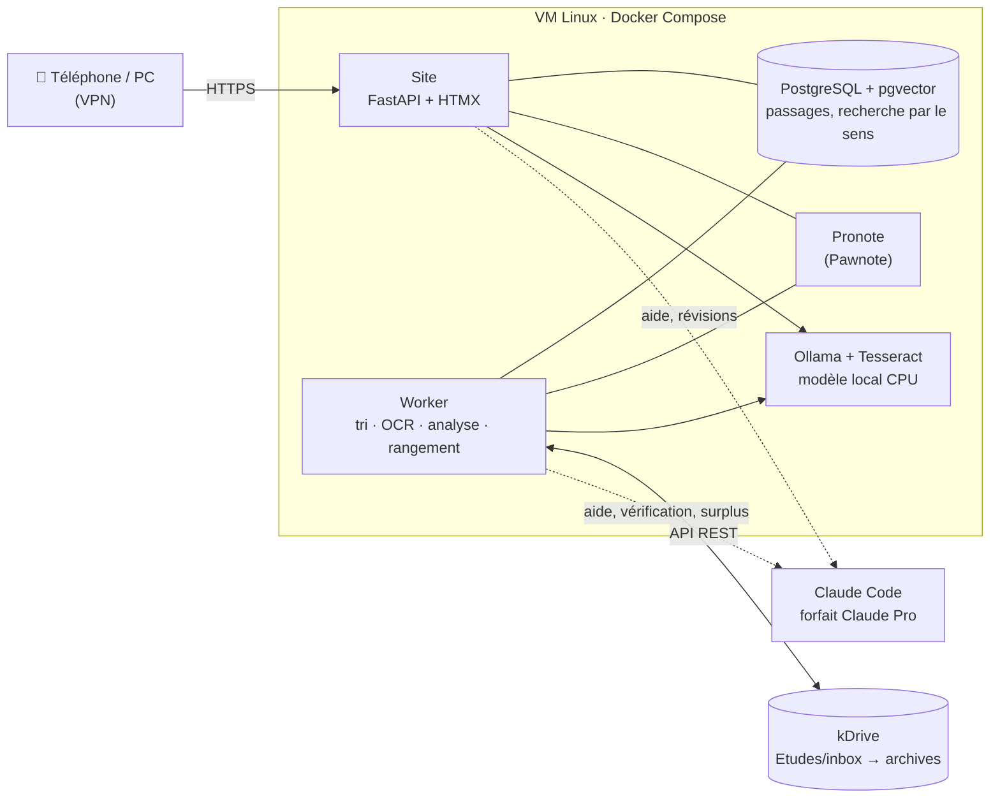
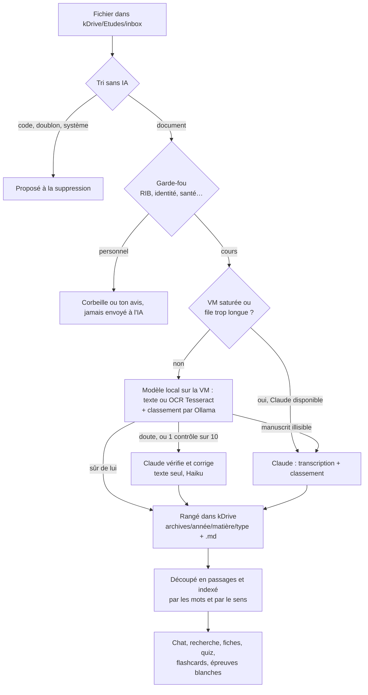
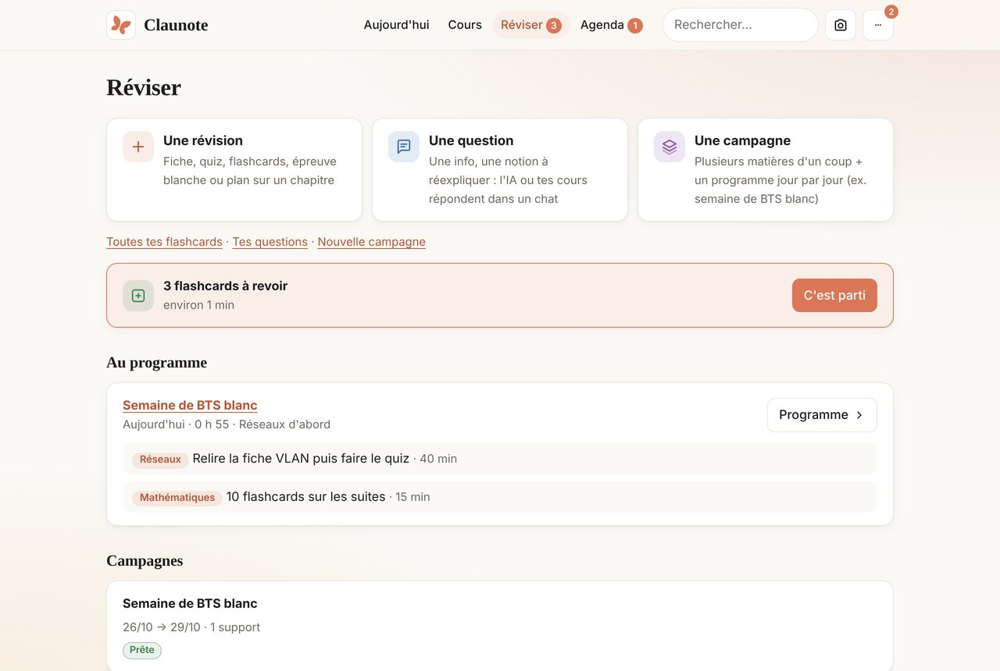
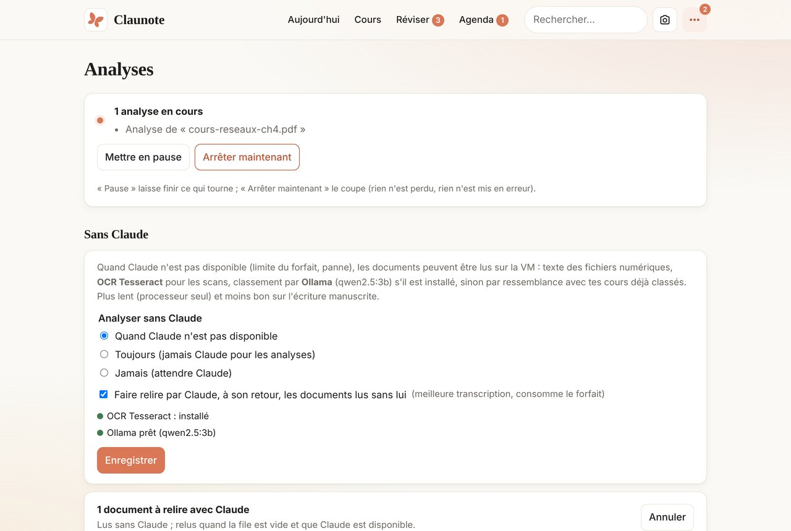
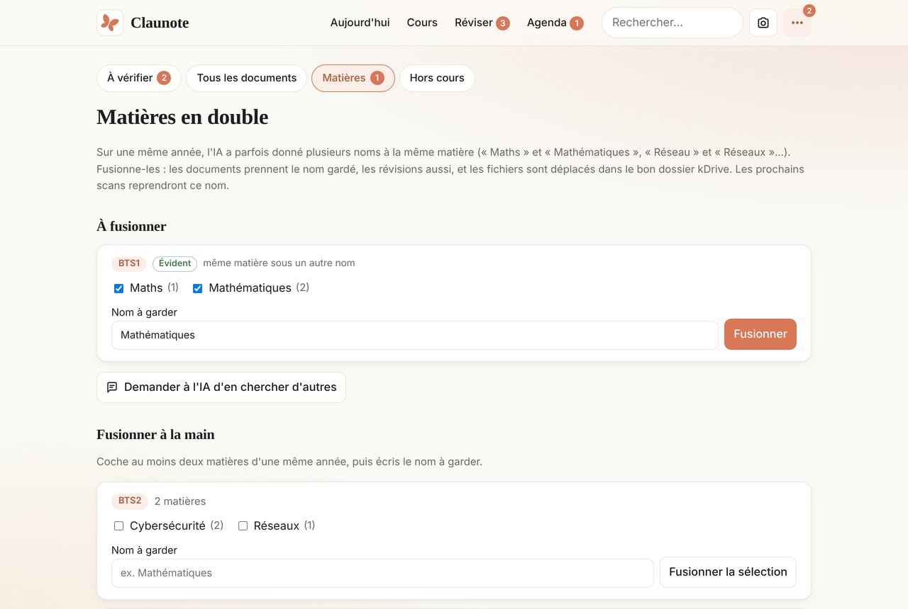

<div align="center">


# Claunote

**Tous tes cours (du collège au BTS) scannés, rangés et transformés en révisions par une IA,
sur ton propre serveur.**

Tu scannes tes cahiers et tes TP, ou tu les déposes depuis ton téléphone. Claunote les lit, les classe par année,
matière et type, puis te prépare des fiches, des quiz, des flashcards et des épreuves blanches qui citent tes
propres cours. Il récupère aussi tes évaluations sur Pronote et te dit quoi réviser aujourd'hui.


</div>

---

## Sommaire

- [Ce que fait Claunote](#ce-que-fait-claunote)
- [Comment ça marche](#comment-ça-marche)
- [Captures](#captures)
- [Installation](#installation)
- [Réglages principaux](#réglages-principaux)
- [Vie privée et coûts](#vie-privée-et-coûts)
- [Développement](#développement)
- [Organisation du code](#organisation-du-code)

## Ce que fait Claunote

| | |
| --- | --- |
| 📥 **Tout ranger sans effort** | Scans, photos d'iPhone (HEIC), PDF, Word, PowerPoint, Excel, scripts et notebooks de TP… Tu déposes un fichier, un dossier entier même mal rangé, ou un scan de 300 pages. Claunote fait le tri sans IA (code, doublons PDF/Word, pages à fusionner), découpe les gros scans en documents, puis l'IA transcrit et classe chaque document dans `kDrive/Etudes/archives/<année>/<matière>/<type>`. |
| 🛡️ **Garde-fou** | Un RIB, une pièce d'identité ou un document de santé oublié dans un import est repéré **sur le serveur, avant l'IA**, et n'est jamais envoyé à Claude. |
| 📚 **Bibliothèque** | Tes cours par année et par matière. Chaque document est découpé en passages et indexé : la recherche trouve le bon morceau du bon cours, par les mots et **par le sens**. |
| 🧠 **Réviser** | Fiche, quiz corrigé, flashcards (répétition espacée **FSRS**, l'algorithme d'Anki, et export Anki), épreuve blanche avec corrigé, plan jour par jour jusqu'à l'évaluation, **carte mentale** de chaque fiche ou cours. Formules de maths, de physique et de chimie dessinées proprement (**KaTeX**). Chaque point renvoie au cours d'origine `[D1]`. Le web n'est utilisé qu'en complément `[W1]`. |
| 📈 **Progression** | Série de jours de travail, flashcards par jour, mémoire estimée par FSRS, réussite par matière (cartes et quiz), moyennes et tendance des notes Pronote. |
| 💬 **Une question** | Un chat (ou la barre de recherche de l'accueil) qui lit **tous tes documents** et ton agenda Pronote. Les passages sont relus et triés par un petit modèle local (**FlashRank**) avant la réponse. Le modèle local répond, Claude vérifie et complète quand il doute. Un mode instantané **sans IA** montre les passages qui en parlent. **Photo d'une formule** → LaTeX dans ta question (**pix2tex**). |
| 🗓️ **Campagnes** | « Semaine de BTS blanc » : plusieurs matières et plusieurs supports d'un coup, plus un programme jour par jour, à cocher, et un livret PDF. |
| 🎓 **Pronote** | Évaluations, devoirs, notes et documents des profs, synchronisés toutes les 3 h. Une fiche ou un plan est préparé tout seul avant chaque contrôle. |
| 🖥️ **Local d'abord** | Le travail interne (lecture, classement, noms de dossiers, matières, chat) est fait **sur le processeur du serveur** : OCR Tesseract et [Ollama](https://ollama.com). Quand le modèle local doute ou n'arrive pas à lire (écriture manuscrite), il demande à Claude, qui vérifie et corrige. Une analyse sûre sur 10 est contrôlée quand même, pour mesurer sa fiabilité. Si la VM sature ou si la file s'allonge, le surplus part chez Claude. Des pics à 100 %, jamais une VM à fond en permanence : au-delà de 60 % en moyenne sur 15 min, le travail de fond ralentit. |
| ⏯️ **Tu gardes la main** | *Activité* : mise en pause, arrêt immédiat des analyses en cours, actions de masse sur la file, choix de qui fait le travail. *Ranger* : documents à vérifier, actions de masse, matières en double (« Maths » / « Mathématiques »). |
| 📰 **Actualités** | Ta veille techno : les flux RSS que tu ajoutes (une adresse de site suffit) et les sujets que tu suis (cybersécurité, réseaux…). Claude (Haiku) trie les nouveaux articles par lots et garde dans « Pour toi » ceux qui comptent, avec une phrase sur ce qu'il faut retenir. Les plus importants sonnent sur le téléphone, regroupés, jamais pendant le silence. Un sujet peut aussi chercher sur Google Actualités. |
| 📱 **Appli iPhone** | Une appli web installable sur l'écran d'accueil, avec notifications push, thème clair ou sombre et **connexion par Face ID** (clés d'accès). Pas d'App Store, pas de compte développeur. |

## Comment ça marche



Le parcours d'un document :



## Captures

<p align="center">
  
</p>

| Aujourd'hui | Réviser |
| --- | --- |
|  |  |
| **Activité** : pause, arrêt, qui fait le travail, fiabilité du local | **Ranger → Matières** |
|  |  |

<sub>Données de démonstration fictives.</sub>

## Installation

Il te faut une VM Linux (4 vCPU et 8 Go de RAM conseillés pour le modèle local ; 2 vCPU et 4 Go avec
`OLLAMA_MODELE=qwen2.5:1.5b`), Docker, un kDrive Infomaniak
et un abonnement Claude Pro. Le guide pas à pas est dans **[infra/SETUP.md](infra/SETUP.md)** : VPN, jeton kDrive,
Claude Code, Pronote, HTTPS pour l'iPhone, notifications.

```bash
git clone https://github.com/ctrljuteau/claunote && cd claunote
cp .env.example .env          # jetons kDrive et Claude, mot de passe du site…
docker compose up -d --build  # site, worker, base, modèles locaux, Pronote, HTTPS
                              # (le modèle local se télécharge tout seul au premier lancement, ~2,3 Go)
```

Ensuite, ouvre `http://<IP-VPN-de-la-VM>:8000`, connecte-toi, et dépose un premier scan.

**Mises à jour** : depuis le site, *Plus → Réglages → Mise à jour → Tout mettre à jour* (réservé au compte connecté).
Le service `maj` fait le `git pull` puis reconstruit et redémarre les services ; un badge prévient quand une
nouvelle version est sur GitHub.

## Réglages principaux

Tout se règle dans `.env` (voir les commentaires de [.env.example](.env.example)). Les réglages du quotidien
se font aussi sur le site.

| Variable | Rôle | Défaut |
| --- | --- | --- |
| `KDRIVE_TOKEN`, `KDRIVE_ID`, `KDRIVE_ETUDES_ID`, `KDRIVE_INBOX_ID` | Accès à kDrive | à remplir |
| `CLAUDE_CODE_OAUTH_TOKEN` | Jeton du forfait Claude Pro (`claude setup-token`) | à remplir |
| `CLAUDE_MODELES`, `CLAUDE_MODELE_MAX` | Un modèle par tâche (Haiku, Sonnet, Opus), plafond | voir la page *État* |
| `CLAUDE_PARALLELE` | Appels à Claude en même temps | `3` |
| `ANALYSE_LOCALE` | Qui fait le travail : `local` (local d'abord), `auto` (Claude d'abord), `toujours`, `jamais` (aussi sur *Activité*) | `local` |
| `OLLAMA_MODELE`, `OLLAMA_EMBED`, `LOCAL_PARALLELE` | Modèle local, modèle de recherche par le sens, analyses locales en même temps | `qwen2.5:3b`, `nomic-embed-text`, `1` |
| `LOCAL_CHARGE_MAX`, `LOCAL_MEMOIRE_MIN_MO`, `LOCAL_ATTENTE_MAX_MIN` | Seuils de saturation : au-delà, le surplus part chez Claude | `0.85`, `600`, `30` |
| `LOCAL_CONTROLE` | Part des analyses locales sûres que Claude contrôle quand même | `0.1` |
| `PRONOTE_INTERVALLE_H`, `PRONOTE_PREPARATION_AUTO` | Synchro Pronote, préparation automatique des contrôles | `3`, `1` |
| `CLAUNOTE_UTILISATEUR`, `CLAUNOTE_MOT_DE_PASSE` | Connexion au site (mot de passe changeable sur le site) | `admin` / `claunote` |
| `DECOUPAGE_PAGES` | Au-delà, un PDF est d'abord découpé en documents | `40` |
| `CPU_MOYENNE_MAX`, `CPU_FENETRE_MIN`, `OLLAMA_THREADS` | Budget du processeur sur la durée (pics permis, pas de VM à fond en permanence), cœurs d'Ollama | `0.6`, `15`, tous sauf un |
| `OLLAMA_GARDER`, `LECTURE_GARDER_MIN` | Mémoire : modèles déchargés après ce temps sans usage (et tout de suite si la mémoire de la VM est basse) | `5m`, `10` |
| `LECTURE_THREADS` | Cœurs du service lecture (Docling, pix2tex, FlashRank) par calcul | `2` |
| `FSRS_RETENTION` | Part des flashcards qu'on veut encore savoir le jour où elles reviennent (plus haut = plus de révisions) | `0.9` |

## Vie privée et coûts

- **Tes fichiers restent chez toi** : dans kDrive et sur ta VM. Le site n'écoute que sur ton VPN.
- **Pas de facturation à l'usage.** Seul le jeton du forfait Claude Pro est utilisé, et une clé API présente
  serait ignorée. À la limite du forfait, Claunote attend, ou bien bascule sur l'analyse locale. Rien n'est
  jamais acheté.
- **Les documents personnels** repérés par le garde-fou ne sont jamais envoyés à Claude.
- **Le modèle local** (Tesseract, Ollama) ne fait sortir aucune donnée de la VM : avec « local d'abord », Claude
  ne voit que ce que le local n'a pas su faire seul, plus un contrôle sur dix.

## Développement

```bash
cd app
pip install -r requirements.txt pytest
pytest                      # ~390 tests, sans base ni kDrive (tout est simulé)
cd ../pronote && npm ci && npm test   # service Pronote
```

Les tests de lecture locale (OCR) se lancent si Tesseract est installé (`apt install tesseract-ocr tesseract-ocr-fra`).

Sur GitHub, ces deux suites tournent à chaque PR (`.github/workflows/tests.yml`), et Dependabot propose chaque mois
les mises à jour de dépendances (`.github/dependabot.yml`) : une PR verte peut être fusionnée, puis installée par
Réglages → Mise à jour.

## Organisation du code

| Fichier | Rôle |
| --- | --- |
| `app/claunote/main.py` | Site FastAPI : pages, formulaires, HTMX |
| `app/claunote/worker.py` | Boucle du worker : inbox, tri, analyses, rangement, révisions, Pronote, pause et arrêt |
| `app/claunote/agent.py` | Appels à Claude Code (`claude -p`), modèle par tâche, escalade, limites, arrêt d'un appel en cours |
| `app/claunote/local.py` | Modèle local : texte, OCR Tesseract, Ollama, appels à l'aide et vérification par Claude |
| `app/claunote/ressources.py`, `index.py` | Saturation de la VM ; passages et recherche par le sens (pgvector) |
| `app/claunote/importation.py`, `decoupage.py`, `sensible.py`, `ocr.py` | Tri d'un import, découpage des gros scans, garde-fou, lecture locale |
| `app/claunote/revision.py`, `question.py`, `pdf.py`, `anki.py` | Supports de révision, flashcards FSRS, chat, PDF, export Anki |
| `app/claunote/progression.py`, `carte_mentale.py`, `formules.py` | Page Progression, cartes mentales (markmap), formules LaTeX (KaTeX, texte des PDF) |
| `app/claunote/lecture.py`, `lecture/` | Docling (Word, PowerPoint, Excel, PDF), service local pix2tex et FlashRank |
| `app/claunote/cles.py` | Connexion par Face ID / Touch ID (clés d'accès WebAuthn) |
| `app/claunote/actualites.py` | Flux RSS (relevé, dédup), tri par sujets (IA ou mots-clés), notifications regroupées |
| `app/claunote/matieres.py`, `rangement.py` | Matières en double, chemins et noms dans kDrive |
| `app/claunote/pronote.py`, `pronote/` | Client Python et service Node (Pawnote) |
| `app/claunote/db.py` | Schéma PostgreSQL (créé et mis à jour au démarrage) et requêtes |
| `app/claunote/maj.py`, `infra/maj/` | Mise à jour depuis le site : le site dépose la demande, le service `maj` l'exécute |
| `infra/` | Caddy (HTTPS local) et guide d'installation |

<details>
<summary><strong>Historique des étapes</strong></summary>

- [x] VM, accès kDrive par API, Docker Compose
- [x] Pipeline d'ingestion : transcription et classement par Claude Code
- [x] Site : bibliothèque, recherche, documents « à vérifier »
- [x] Agent de révision : fiches, quiz, plans, sources citées
- [x] Pronote : agenda, devoirs, notes, documents des profs, préparation en un clic
- [x] Flashcards (répétition espacée), export Anki, appli installable
- [x] Organiser : reclassement, actions de masse, espace « Hors cours »
- [x] Appli iPhone (HTTPS local, style Liquid Glass), notifications push
- [x] Imports de dossiers entiers, garde-fou des documents personnels, découpage des très gros scans
- [x] Campagnes multi-matières, épreuves blanches, PDF à partager, fichiers joints au contexte
- [x] « Une question » : chat avec l'IA ou sans IA
- [x] Actualités : flux RSS, sujets suivis triés par l'IA, notifications
- [x] Matières en double : détection, fusion, prévention
- [x] Analyse sans Claude sur CPU (Tesseract + Ollama), pause et arrêt des analyses, file d'analyse
- [x] Local d'abord : Claude n'aide que si besoin et vérifie ; saturation surveillée ; index par passages et par le sens ;
  code des TP lu comme un cours ; menus regroupés (Ajouter, Ranger, Activité, Réglages)

</details>
