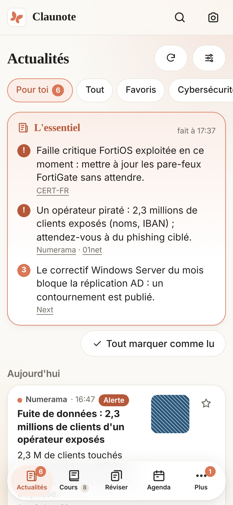
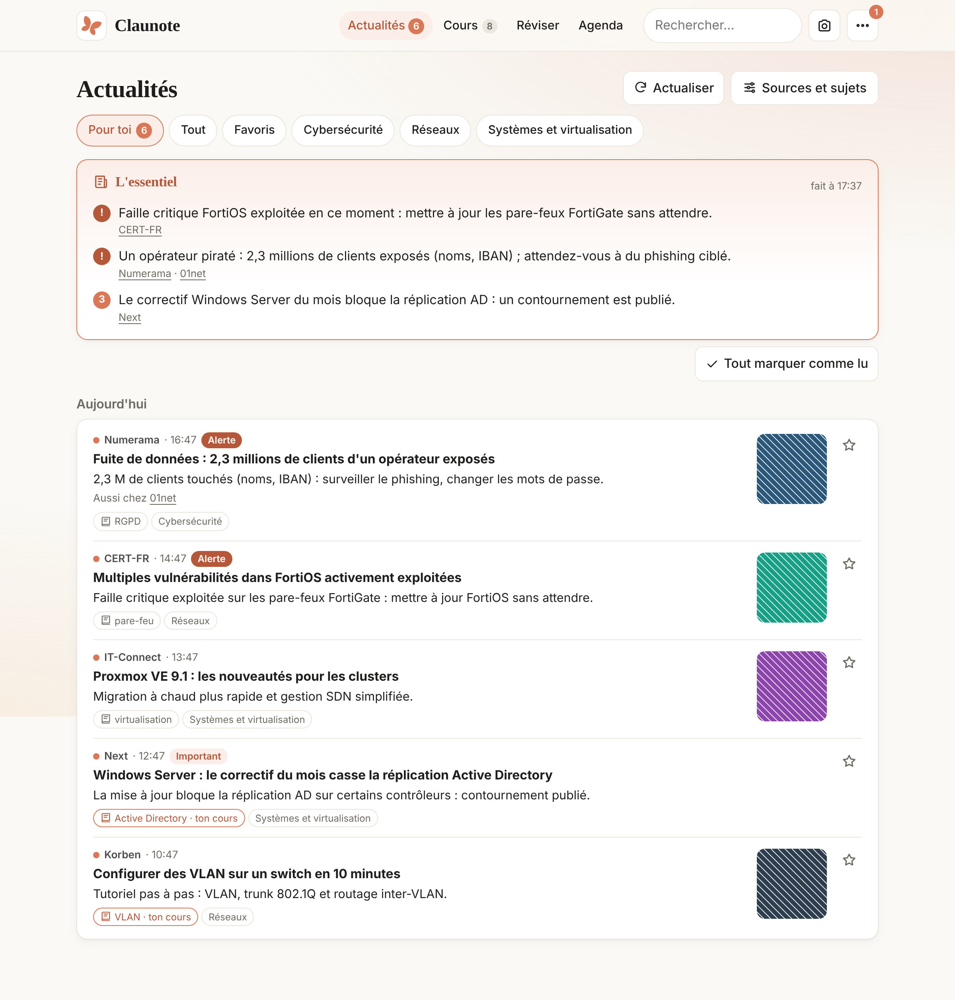
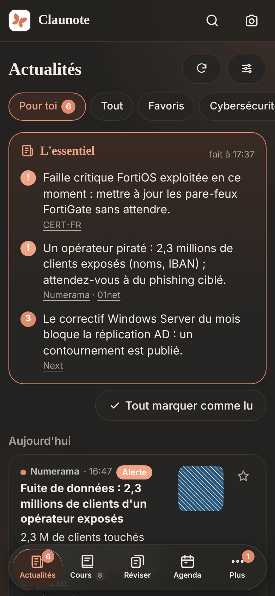
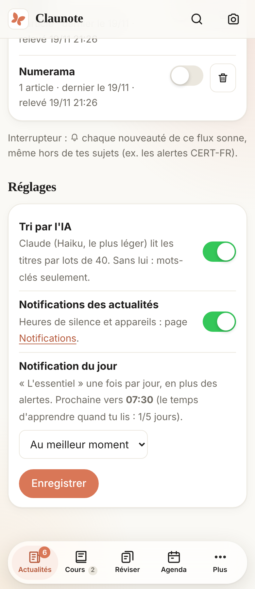
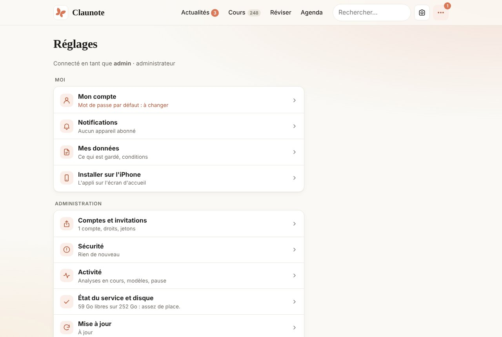

<div align="center">


# Claunote

**English** · [Français](README.fr.md)

**Your scanned class notes, organized and turned into revision material by AI, plus a news feed sorted for you.
Self-hosted on your own server.**

Scan your notebooks and lab work (or drop them from your phone). Claunote reads them, files them by year and
subject, then builds **summary sheets, quizzes, flashcards and mock exams that cite your own notes**.
Every day, it sums up **the news that matters** in your field.


&nbsp;


</div>

> [!NOTE]
> The app interface and the AI-generated content are **in French** for now (it was built for French students,
> with a [Pronote](https://www.index-education.com/fr/logiciel-gestion-vie-scolaire.php) integration).
> This README is the English overview; the detailed docs are in French.

---

**Contents** · [News](#-news-your-daily-briefing-with-no-effort) · [Features](#features) ·
[Screenshots](#screenshots) · [Quick start](#quick-start) · [Privacy and costs](#privacy-and-costs) ·
[Documentation](#documentation) · [License](#license)

## 📰 News: your daily briefing with no effort

The app opens on this page. Add websites (a plain address is enough, the RSS feed is found automatically) and
topics to follow. **Claude sorts, summarizes and groups** the articles; you only read what matters.

<p align="center">
  
</p>

| | |
| --- | --- |
| 🗞️ **Today's essentials** | At the top of "For you": **the 3 to 5 stories of the moment, one sentence each**, with sources. Written by **Claude Opus 5.5**, refreshed at most every 3 hours (immediately for an alert). |
| 🔔 **Daily notification** | The essentials arrive **once a day, at the time you usually read** (learned over 4 weeks, 7:30 AM to start). Fixed time or off, if you prefer. |
| 🚨 **Rare alerts** | Only **serious** events ring right away: major data leak, actively exploited critical flaw, major outage. **Once per event**, never during your quiet hours. |
| 🧩 **One story = one card** | The same event covered by 3 sites becomes **a single card** ("Also on …"). One-sentence summary per article. |
| 📚 **Linked to your notes** | When an article mentions a concept from your classes (VLAN, Active Directory, GDPR…), a **"your notes"** link opens the right document. |
| 🎯 **For any curriculum** | Starter topics are editable; sorting takes **the curriculum you entered** into account. Optional Google News per topic, favorites, "Mark all as read". |

<p align="center">
  
  &nbsp;
  
</p>

How a story flows from RSS feed to notification: **[News diagram](docs/schemas.md#actualités--du-flux-rss-à-la-notification)** (French).

## Features

| | |
| --- | --- |
| 📥 **Effortless filing** | Scans, iPhone photos, PDF, Word, PowerPoint, Excel, lab code… One file, **a whole messy folder** or a 300-page scan: rule-based pre-sorting, splitting of large scans, then reading and filing by **year / subject / type**. |
| 🎓 **Subjects per curriculum** | Enter your curriculum for each year: Claude fetches **the official syllabus** and suggests the right subject names. Every correction becomes **a rule** applied to future uploads. Duplicates ("Maths" / "Mathematics") are detected and merged. |
| 🧠 **Revise in one sentence** | "a summary sheet on employment contracts for Thursday" is enough. **Dense summary sheet** (3-column A4 PDF, editable with a simple request), graded quiz, **FSRS** flashcards (Anki export), mock exam, day-by-day plan, mind map, KaTeX formulas. Every point links back to your notes `[D1]`. |
| ✨ **Opus 5.5 for creation** | **All content creation goes through Claude Opus 5.5**, with a safeguard that compares against your previous sheets to avoid going off-topic. |
| 💬 **Ask a question** | A chat that reads **all your documents** and your school calendar. Instant mode without AI, photo of a formula → LaTeX. |
| 🗓️ **Campaigns** | "Mock exam week": several subjects at once, a day-by-day checklist, a PDF booklet. |
| 🎓 **Pronote** | Tests, homework, grades and teacher documents every 3 hours, timetable-aware notifications; a sheet is **prepared automatically before each test**. |
| 👥 **Multiple accounts** | 15-minute invitations, **per-feature permissions** (including use of your Claude plan). Each account's data is isolated in the database. |
| 🔒 **Public or private** | Each course, subject, sheet or campaign: **🔒 Only me** (default) or **🌐 All accounts**. Read-only *Shared* page. |
| 🗄️ **Archives** | Clean-up is **suggested, never automatic**: past tests, neglected flashcards and sheets. Archive, keep or restore. |
| 🛡️ **Safeguard** | Bank details, ID documents, health records: detected **on the server, before any AI**, and never sent to Claude. |
| 🖥️ **Local first** | Reading, filing and chat run **on the server's CPU** (Tesseract + Ollama). Claude only steps in when the local model is unsure, and spot-checks 1 in 10. |
| 📱 **iPhone app** | Installable on the home screen: push notifications, light/dark theme, **Face ID**. No App Store. |

## Screenshots

<p align="center">
  
</p>

| Settings | Revise |
| --- | --- |
|  |  |
| **Activity**: pause, stop, who does the work | **Organize → Subjects** |
|  |  |

<sub>Fictional demo data.</sub>

## Quick start

You need **a Linux VM with Docker** (4 vCPU · 8 GB RAM · 40 GB disk recommended, no GPU), **a Claude Pro or Max
subscription** and **a VPN** (or Cloudflare Tunnel). Infomaniak kDrive and Pronote are optional.

```bash
git clone https://github.com/juteaucorp/claunote && cd claunote
cp .env.example .env            # set POSTGRES_PASSWORD and BIND_ADDR (the VM's IP on your VPN)
docker compose up -d --build    # 10 to 20 min the first time (local model ~2.3 GB)
```

Open `http://<VM-IP>:8000` and sign in with `admin` / `claunote`: **a step-by-step wizard** has you choose your
password and storage (kDrive, the VM or both), paste your Claude token (`claude setup-token`) and connect Pronote.
Tokens are **encrypted** and never shown again.

➡️ Full details (requirements, `.env`, VPN or Internet access, accounts, updates, settings, troubleshooting):
**[docs/installation.md](docs/installation.md)** (French).

## Privacy and costs

- **Your files stay with you**: on your VM and/or your kDrive. The site is **never exposed directly** to the
  Internet (VPN, or Cloudflare Tunnel restricted to your approved devices).
- **No pay-per-use billing**: only your Claude subscription token is used; an API key would be ignored.
  When the plan limit is reached, Claunote waits or switches to local models. Nothing is ever purchased.
- **Personal documents** caught by the safeguard are never sent to Claude.
- **Local model**: nothing leaves the VM; Claude only sees what the local model couldn't handle on its own.

## Documentation

The detailed docs are in French.

| | |
| --- | --- |
| 🛠️ **[Install and administer](docs/installation.md)** | Requirements, installation, `.env`, access, accounts, updates, advanced settings, troubleshooting |
| 🗺️ **[Diagrams](docs/schemas.md)** | Overview, document lifecycle, News, local vs Claude, access, accounts, updates |
| 📋 **[Step-by-step guide](infra/SETUP.md)** | Each step with its checks: kDrive, Pronote, iPhone, notifications, Face ID, local models |
| 🌐 **[Cloudflare Tunnel](docs/cloudflare-tunnel.md)** | Reach the site over the Internet without a VPN, approved devices |
| 👩‍💻 **[Development](docs/developpement.md)** | Tests, code layout, project history |
| 🔐 **[Security](SECURITY.md)** | Report a vulnerability |

## License

[MIT](LICENSE).
