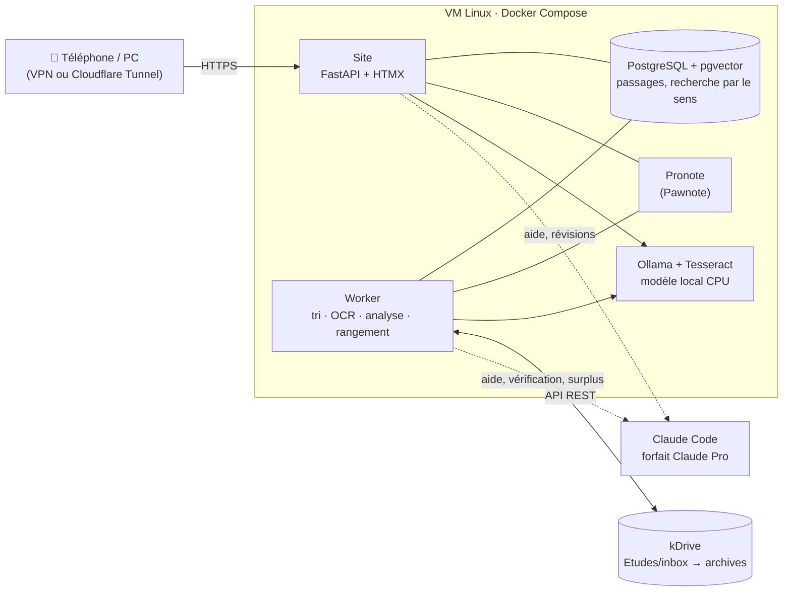
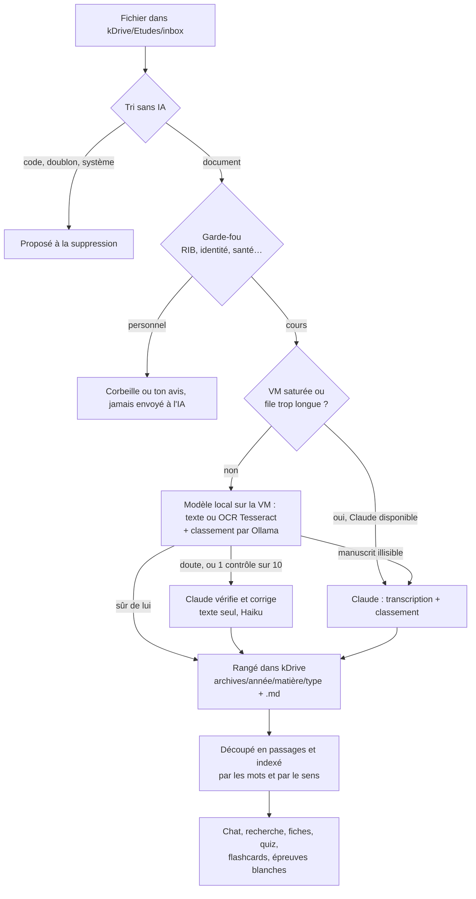
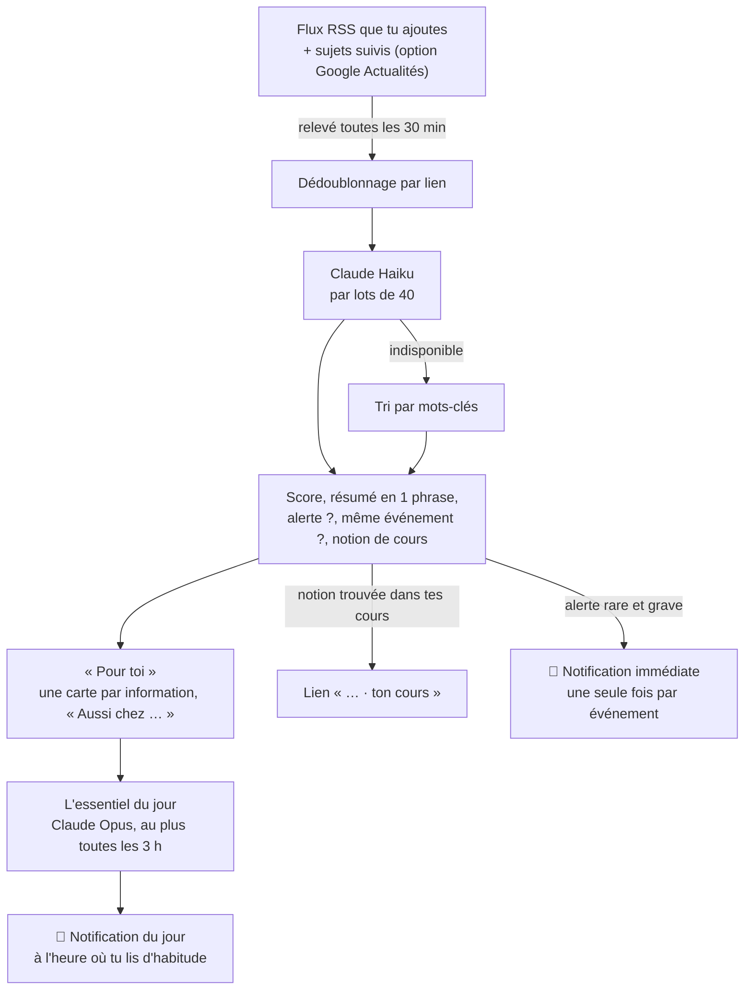
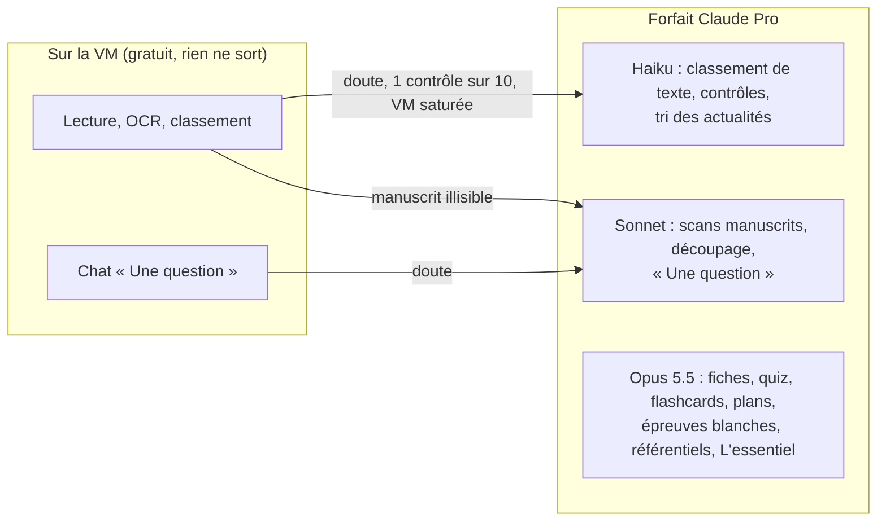
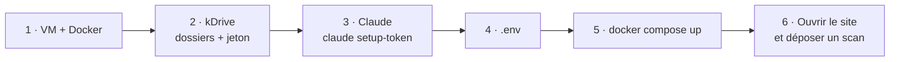

# Schémas

[← Retour au README](../README.md) · Installation : [installation.md](installation.md)

## Sommaire

- [Vue d'ensemble](#vue-densemble)
- [Le parcours d'un document](#le-parcours-dun-document)
- [Actualités : du flux RSS à la notification](#actualités--du-flux-rss-à-la-notification)
- [Qui fait le travail : local ou Claude](#qui-fait-le-travail--local-ou-claude)
- [Installation à la main](#installation-à-la-main)
- [Ouvrir le site : VPN ou Internet](#ouvrir-le-site--vpn-ou-internet)
- [Plusieurs comptes](#plusieurs-comptes)
- [Public ou privé](#public-ou-privé)
- [Mise à jour depuis le site](#mise-à-jour-depuis-le-site)

## Vue d'ensemble



## Le parcours d'un document



## Actualités : du flux RSS à la notification



- **Alerte** = rare et grave seulement (grosse fuite de données, faille critique exploitée, panne majeure).
- **Heure de la notification du jour** : apprise de tes ouvertures des Actualités sur 28 jours (7 h 30 par défaut),
  ou fixée à la main, ou coupée (*Sources et sujets → Réglages*).
- Rien ne sonne pendant tes heures de silence.
- **À chaque compte son fil** : ses sources, ses sujets, ses articles lus ou favoris, son « Essentiel » et ses
  alertes, sur ses appareils et selon ses réglages de notification. Un compte sans forfait Claude reprend le
  résumé et l'alerte que l'IA a donnés au même article chez l'admin, rangés dans ses sujets par mots-clés
  (pas d'« Essentiel » pour lui : la notification du jour compte ses articles).
- **Fil par défaut** : un compte qui n'a rien changé suit le fil choisi par l'admin (*Sources et sujets → Fil par
  défaut pour tout le monde*, « Mettre mon fil par défaut »), sinon la sélection de départ, alertes urgentes
  activées. Il change une source ou un sujet : son fil devient le sien ; « Revenir au fil par défaut » l'y remet.
- **Fil de l'admin par défaut, en permanence** (activé tant que l'admin ne le coupe pas) : chaque changement de son
  fil devient le fil par défaut. Un compte qui le suit reprend ses articles, son tri par l'IA et son « Essentiel » :
  ni relevé ni IA pour lui ; seules ses alertes (sur ses appareils), ses lectures et ses favoris sont à lui.
- **L'essentiel du jour pour les autres comptes** : avec le droit « L'essentiel du jour » (page Comptes). Même fil
  que l'admin : son point est repris, sans rappeler Claude ; fil différent : Claude Opus le fait sur le forfait de
  l'admin, même sans autonomie.

## Qui fait le travail : local ou Claude



Toute **création de contenu** passe par **Opus 5.5**. S'il est à sa limite, la création attend sa reprise
(`CLAUDE_REPLI_CREATION=1` pour repasser sur Sonnet).

## Installation à la main



## Ouvrir le site : VPN ou Internet

```
 ┌─ Par ton VPN (par défaut) ─────────────────────────────────────────────┐
 │ Téléphone / PC ──VPN──► http://BIND_ADDR:8000   (ou https://CLAUNOTE_HOTE pour l'iPhone)
 └────────────────────────────────────────────────────────────────────────┘
 ┌─ Par Internet, sans VPN (facultatif) ──────────────────────────────────┐
 │ Appareil approuvé ──► Cloudflare (https://claunote.ton-domaine.fr) ──tunnel sortant──► VM
 │ Aucun port ouvert. Un appareil inconnu ne voit que la page « code d'appareil ».
 └────────────────────────────────────────────────────────────────────────┘
```

## Plusieurs comptes

```
 admin ──Réglages → Comptes → « Inviter »──► jeton (15 min, un seul usage)
                                               └─► /invitation : la personne choisit identifiant + mot de passe
                                                   et accepte les conditions d'utilisation
 chaque compte ──► ses propres cours, fiches, cartes, questions (la base le garantit : row-level security)
 admin ──« Tout voir »──► les données de tous les comptes (bandeau visible, noté dans Sécurité)

 Ranger : chacun range ce qu'il a déposé
   dépôt d'un invité ──► son tri d'import, ses « À vérifier », ses notifications « à ranger »
                     ──► l'IA classe avec SES matières, SA formation, SES règles de rangement
   admin (même en « Tout voir ») ──► sa file et ses pastilles ne comptent que ses dépôts ;
                                      Import, Matières et Déposer restent les siens ;
                                      les dépôts des autres : comptés sur À vérifier, ouverts dans Tous les documents
```

## Public ou privé

```
 chaque cours, matière, fiche, campagne ──► « Qui peut voir ? »
      🔒 Moi seul (par défaut)  │  🌐 Tous les comptes  │  Comme la matière (pour un cours)
 page Partagés ──► ce que les autres comptes ont rendu public, en lecture seule
 seul le propriétaire change ce choix ; « Tout voir » de l'admin n'en dépend pas
```

## Mise à jour depuis le site

```
 site ──demande──► service maj ──► git pull ──► docker compose build ──► up -d
  ▲                    │
  └── état + journal ──┘        (le site ne peut demander que 4 actions fixes, jamais une commande libre)
```
